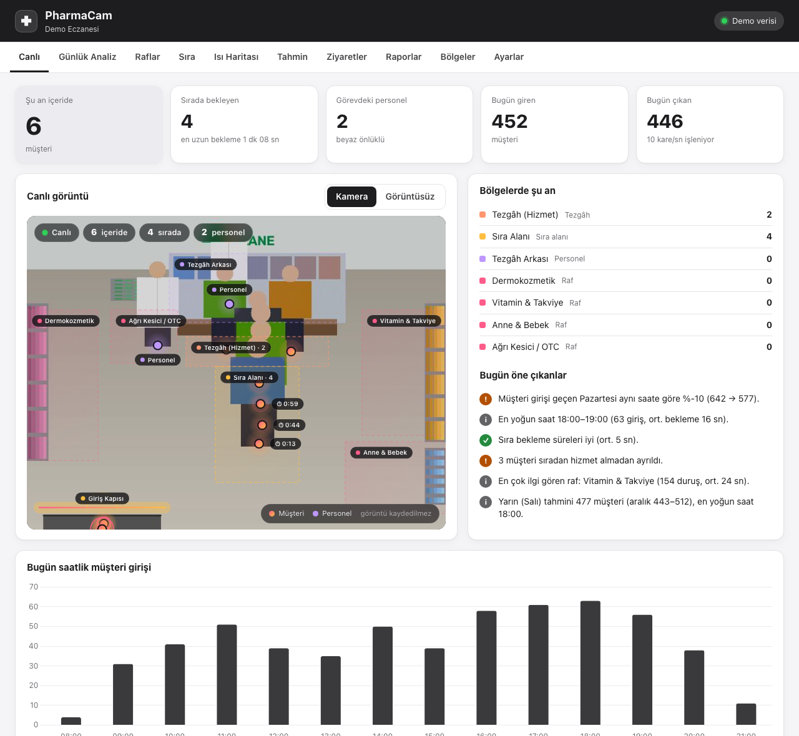

# ✚ PharmaCam

**Eczaneler için çip üzerinde yapay zekâ ile mağaza analitiği.**
Raspberry Pi 5 + Raspberry Pi AI Camera (Sony IMX500) ile eczaneye giren müşterileri sayar; sırada bekleme sürelerini,
raf önünde durma davranışını ve mağaza ısı haritasını çıkarır. Beyaz önlüklü personeli müşterilerden ayırır, ertesi günün
müşteri yoğunluğunu tahmin eder ve her akşam PDF rapor üretir. **Görüntü kaydedilmez, yüz tanıma yapılmaz.**

[**Ürün sayfası ve canlı demo**](https://umutcan-integrity.github.io/pharmacam/) ·
[**Kurulum kılavuzu (PDF)**](docs/PharmaCam-Kurulum-Kilavuzu.pdf) ·
[Yol haritası](ROADMAP.md)



## Ne ölçer?

| Gösterge | Açıklama |
|---|---|
| Giren / çıkan müşteri | Kapıya çizilen sanal çizgiyi yönüyle geçenler. Histerezis ve kapıda kopan takipler için düzeltme içerir. |
| Anlık içerideki kişi | Kamerada görünen müşteri ile kapı sayacı birlikte (hibrit, otomatik sıfırlamalı) |
| Raf önünde durma | Bölge bazlı duruş/geçiş, durma oranı, ortalama ve en uzun süre |
| Sıra analizi | Sıra uzunluğu, bekleme ve hizmet süresi, sıradan vazgeçenler, %90 bekleme |
| Isı haritası | Müşterilerin vakit geçirdiği alanlar (saatlik saklanır, gün/hafta/ay) |
| Personel ayrımı | Gövdede beyaz önlük oranı ile tezgâh arkasında geçen süre birlikte değerlendirilir |
| Anonim ziyaret kaydı | Giriş/çıkış saati, süre, gezilen raflar, sıra ve hizmet süresi (kimlik yok) |
| Kişi tahminleme | 7 gün ileri saatlik müşteri tahmini, güven aralığı ve tezgâh personeli önerisi |
| Günlük rapor | Her kapanışta 4 sayfalık PDF: göstergeler, grafikler, raf tablosu, ısı haritası, yarın tahmini |

## Mimari

```
IMX500 AI Camera ──► Raspberry Pi 5 ─ pharmacam servisi ───────────────────────────► Web paneli :8080
 (YOLO11n 640,        ├─ ByteTrack-lite takip              ├─ REST API (/docs)
  kişi tespiti çipte)  ├─ Analitik: kapı / sıra / raf / ısı  ├─ Günlük PDF rapor + tahmin
                       ├─ Önlük (personel) sınıflandırıcı    └─ Bulut senkronizasyonu ──► PharmaCam Hub
                       └─ SQLite (400 gün geçmiş)                (kuyruklu, kayıpsız)        (çoklu eczane)
```

Analiz hattı Raspberry Pi 5'te kare başına **1,25 ms** sürer (1280×960). Darboğaz işlemci değil, kameradır.

## Kurulum (Raspberry Pi 5)

1. AI Camera'yı Pi 5'in CAM/DISP konnektörüne **Standard–Mini** kabloyla takın. Metal temaslar kilit tırnağının tersine bakmalı; Pi kapalı olmalı.
2. Raspberry Pi OS (64-bit) kurun ve SSH ile bağlanın.
3. Tek komut:

```bash
curl -sSL https://raw.githubusercontent.com/umutcan-integrity/pharmacam/main/deploy/install.sh | bash
```

4. `http://<pi-adresi>:8080` adresine girin. Kurulum çıktısındaki şifreyle `admin` olarak oturum açın. **Bölgeler** sekmesinde kapı, sıra, tezgâh ve rafları çizin.

Ayrıntılar, montaj şemaları ve sorun giderme için: [Kurulum kılavuzu (PDF)](docs/PharmaCam-Kurulum-Kilavuzu.pdf)

## Donanımsız geliştirme (simülatör)

Gerçekçi bir eczane simülatörü vardır: müşteriler raflarda durur, sıraya girer, hizmet alır; beyaz önlüklü personel çalışır.
Tüm analiz hattı aynı kodla çalışır.

```bash
python3 -m venv .venv && .venv/bin/pip install -r requirements-dev.txt
.venv/bin/python -m pharmacam -c config/pharmacam.simulator.yaml backfill --days 35   # geçmiş veri üret
.venv/bin/python -m pharmacam -c config/pharmacam.demo.yaml run                       # http://localhost:8080
.venv/bin/python -m pytest                                                            # testler
```

## Komutlar

| Komut | Açıklama |
|---|---|
| `python -m pharmacam run` | Servis: kamera + analiz + API + zamanlanmış işler |
| `python -m pharmacam check` | Kamera/model testi (fps, görülen kişi) |
| `python -m pharmacam models --fetch` | Yapay zekâ modellerini listele, seçili olanı indir ve doğrula |
| `python -m pharmacam report --day YYYY-MM-DD` | Günlük PDF rapor |
| `python -m pharmacam backfill --days N` | Simülasyonla geçmiş veri (yalnızca simülatör yapılandırması) |
| `uvicorn --factory pharmacam.hub.app:create_hub` | Çoklu eczane merkezi (Hub) |

## API

Cihazda etkileşimli belgeler: `http://<pi>:8080/docs`. Başlıca uç noktalar:
`/api/live`, `/api/summary`, `/api/hourly`, `/api/daily`, `/api/zones/stats`, `/api/queue`, `/api/heatmap`,
`/api/visits`, `/api/export/visits.csv`, `/api/forecast`, `/api/insights`, `/api/reports`, `/api/config/zones`.
Hub tarafı: `POST /api/v1/ingest` (cihaz anahtarı ile), `/api/v1/devices`, `/api/v1/overview`.

## Proje yapısı

```
pharmacam/
  camera/      imx500.py (gerçek kamera) · simulator.py (sanal eczane)
  vision/      tracker.py · staff.py (önlük) · geometry.py
  analytics/   engine.py (canlı analiz) · queries.py · forecast.py · insights.py · heatmap.py
  storage/     db.py (SQLite, WAL)
  api/         app.py (FastAPI) · static/ (web paneli)
  reports/     daily.py (PDF)
  sync/        client.py (cihaz → hub)
  hub/         app.py (çoklu eczane merkezi)
config/        örnek, simülatör ve demo yapılandırmaları
deploy/        install.sh · systemd servisi · hub Docker
docs/          kurulum kılavuzu (HTML kaynağı + PDF) · görseller
scripts/       build_site.py (GitHub Pages) · build_docs.sh · screenshots.sh
tests/         birim + uçtan uca testler
```

## Yapay zekâ modeli

Kişi tespiti kameranın çipinde çalışan bir modelle yapılır (`camera.model`). Pi 5 + AI Camera üzerinde ölçüldü:

| Ön ayar | Model | COCO mAP (INT8) | Kamera / analiz | Lisans |
|---|---|---|---|---|
| `yolo11n` (varsayılan) | YOLO11n 640×640 | 0,374 | 15 / 15 kare/sn — her kare analiz edilir | AGPL-3.0 |
| `nanodet` | NanoDet-Plus 416×416 | 0,320 | 30 / 15 kare/sn | Apache-2.0 |
| `ssd` | SSD MobileNetV2 FPNLite 320×320 | 0,218 | 30 / 15 kare/sn | MIT |

`yolo11n` dosyası Raspberry Pi'nin resmi [imx500-models](https://github.com/raspberrypi/imx500-models) deposundan
indirilir ve sha256 ile doğrulanır; indirilemezse cihaz geçici olarak `ssd` ile çalışmaya devam eder.

> **Lisans:** YOLO11n (Ultralytics) AGPL-3.0 lisanslıdır. Kapalı kaynaklı ticari bir üründe kullanmak için
> Ultralytics Enterprise lisansı gerekir; alternatif olarak `nanodet` (Apache-2.0) seçilebilir.

## Gizlilik

Kişi tespiti kamera çipinde yapılır. Görüntü diske yazılmaz ve buluta gönderilmez. Kişiler geçici bir takip numarasıyla izlenir.
Saklanan veriler sayılar ve sürelerdir. Canlı görüntü yalnızca anlık izlenir, hiçbir kare kaydedilmez; istenirse kişiler bulanıklaştırılır ya da canlı görüntü tamamen kapatılır.
Kılavuzun 14. bölümünde örnek KVKK aydınlatma metni bulunur.
